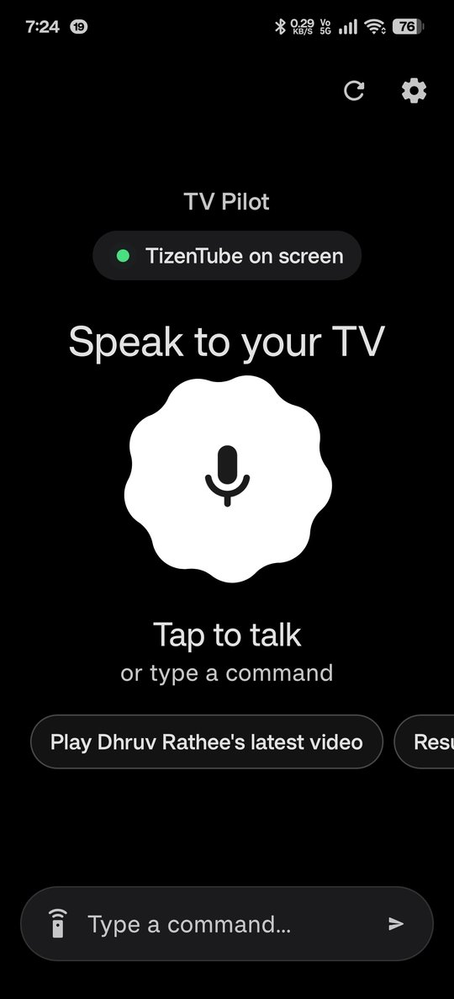
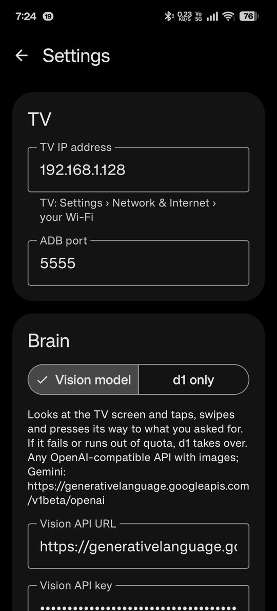
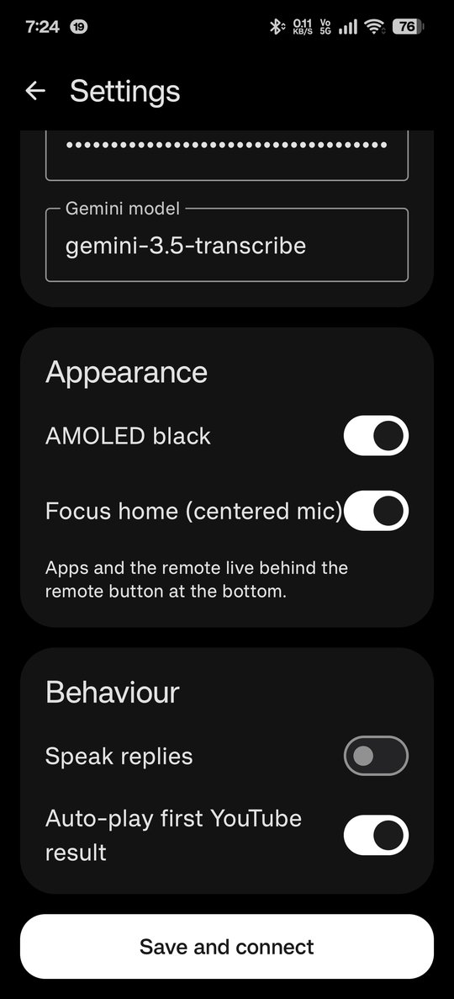

<div align="center">


# TV Pilot

**Talk to your Google TV. It looks at the screen and does it for you.**

An AI voice remote for Android / Google TV, built with Kotlin and Jetpack Compose (Material 3 Expressive).

&nbsp;&nbsp;
&nbsp;&nbsp;


</div>

---

## What it does

Say *"play Dhruv Rathee's latest video"*, *"resume my show on Nuvio"* or *"volume up 3"*, and TV Pilot does it on your TV.

- **Vision agent.** A multimodal model (Gemini 3.5 Flash-Lite by default, or any OpenAI-compatible API that takes images) gets a screenshot of the TV. It picks one action (tap, D-pad key, swipe, type, open app, search, wait), runs it, then looks again until the job is done. A live card shows the TV screenshot, a checklist of steps, and a Stop button.
- **Instant remote commands.** Pause, volume, back, home and similar never wait on a model.
- **Voice, your way:**
  - **Gemini 3.5 Transcribe.** Handles Hinglish and code-switching, and is biased toward the names of your installed apps.
  - **Phone.** Android's built-in speech recogniser.
  - **Parakeet.** Your own server (any OpenAI-style `/v1/audio/transcriptions` endpoint).
- **Custom instructions.** Rules the agent always follows, per app. For example: *"In Nuvio, after pressing Play, wait for providers, skip 'Support the project', pick PenguPlay."*
- **Bluetooth remote.** The phone acts as a Bluetooth HID media remote, so your own button presses reach the TV with no ADB lag. The agent always uses ADB, so the two never clash.
- **Home-screen widgets.** A frosted 2×2 mic and a 4×2 remote with status and play, volume and home buttons. Tap the mic to start talking.
- **Backup brain (optional).** A small decision model (e.g. Liquid AI d1) on your own server takes over if the vision API fails or runs out of quota.
- **Polished UI.** A focus home with a big morphing mic, a smooth mic-to-bar transition, an AMOLED black mode, and a remote and apps sheet.
- **Works with any app.** YouTube / TizenTube, Netflix, Prime Video, JioHotstar, Crunchyroll, Nuvio, Stremio, Plex and more. Installed TV apps are detected on their own.

## How it works

```
 voice ─▶ transcription ─▶ quick command?  ──yes──▶ key press (Bluetooth or ADB)
                                │ no
                                ▼
            vision agent loop: screenshot ─▶ model ─▶ one action ─▶ repeat until done
                                │ API error
                                ▼
                       optional backup decision model
```

The phone talks to the TV directly over **network ADB** with [dadb](https://github.com/mobile-dev-inc/dadb). No PC, no root, and no app on the TV.

## Setup

1. **On the TV:** turn on Developer options (Settings › System › About › tap *Build* 7 times). Then turn on **USB debugging** and **Network debugging** (on some TVs, *ADB over network*).
2. Find the TV's IP: Settings › Network & Internet › your Wi-Fi.
3. **In TV Pilot › Settings:**
   - Enter the TV IP (port `5555`), then tap **Save and connect**. Accept *"Allow USB debugging?"* on the TV and tick **Always allow**.
   - **Brain:** choose *Vision model* and paste a Gemini API key from [AI Studio](https://aistudio.google.com/apikey). The default URL is `https://generativelanguage.googleapis.com/v1beta/openai`.
   - **Voice:** pick Google › *Gemini API* (the key field can stay blank to reuse the brain key) or *Phone*.
   - *(Optional)* **Remote:** turn on Bluetooth remote and tap **Pair with TV**.
4. Tap the mic and talk.

All server fields ship **empty**. Bring your own keys and servers.

## Build

Requirements: JDK 21, Android SDK 37.

```bash
./gradlew assembleRelease
```

Optional build-time defaults (kept out of the source):

```bash
./gradlew assembleRelease -Pd1Url=https://your-server -Pd1Key=... -PasrUrl=https://your-asr-server
# or the env vars D1_URL, D1_KEY, ASR_URL
```

Add `-PabiSplits=1` for separate arm64-v8a and armeabi-v7a APKs.

To keep updates installable over older builds, sign with your own fixed keystore: `-PtvpilotKeystore=/path/to/your.keystore`.

## Tech

Kotlin · Jetpack Compose · Material 3 Expressive (1.5.0-beta01) · DataStore · OkHttp · dadb (ADB) · ML Kit text recognition · Android Bluetooth HID Device API · Gemini API (OpenAI-compatible chat + Interactions API for transcription)

## Privacy

Keys and settings stay on your phone (DataStore). Screenshots and audio go only to the APIs you configure.

## License

[MIT](LICENSE) © 2026 Syed Arshaan ([@Ichiro786](https://github.com/Ichiro786))
